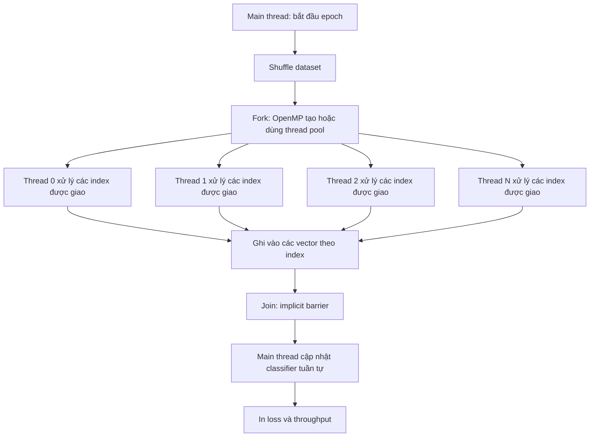

# Vision Transformer OpenMP

Triển khai Vision Transformer (ViT) bằng C/C++, có hỗ trợ OpenMP và OpenCV. Project hiện cung cấp pipeline đọc ảnh CIFAR-10 dạng thư mục, forward pass của ViT và bước train classification head.

## 1. Yêu cầu môi trường

- Linux hoặc môi trường có `bash`
- GCC/G++
- GNU Make
- OpenMP
- OpenCV 4 và gói phát triển (`opencv4.pc`)

Trên Ubuntu/Debian có thể cài các gói cần thiết bằng:

```bash
sudo apt update
sudo apt install build-essential pkg-config libopencv-dev
```

Kiểm tra OpenCV:

```bash
pkg-config --modversion opencv4
```

## 2. Chuẩn bị dataset CIFAR-10

`Cifar10Dataset` không đọc file CIFAR-10 binary. Loader yêu cầu ảnh `.png`, `.jpg` hoặc `.jpeg`, kích thước chính xác `32x32`, được sắp xếp theo cấu trúc:

```text
datasets/
└── cifar10/
    ├── train/
    │   ├── airplane/
    │   ├── automobile/
    │   ├── bird/
    │   ├── cat/
    │   ├── deer/
    │   ├── dog/
    │   ├── frog/
    │   ├── horse/
    │   ├── ship/
    │   └── truck/
    └── test/
        ├── airplane/
        ├── automobile/
        ├── bird/
        ├── cat/
        ├── deer/
        ├── dog/
        ├── frog/
        ├── horse/
        ├── ship/
        └── truck/
```

Thứ tự nhãn là:

```text
0 airplane       5 dog
1 automobile     6 frog
2 bird           7 horse
3 cat            8 ship
4 deer           9 truck
```

Ảnh được đọc bằng OpenCV và chuẩn hóa từng giá trị pixel về khoảng `[0, 1]`. Chương trình train hiện dùng split `train` tại đường dẫn cố định `datasets/cifar10/train`.

> Lưu ý: `dowload_datasets.py` hiện là script mẫu dùng Ultralytics/YOLO, không tạo cấu trúc dataset mà chương trình C++ yêu cầu. Cần chuẩn bị và chuyển đổi dataset thành cấu trúc ở trên trước khi train.

## 3. Kiểm tra dataset

Build và chạy bài kiểm tra loader:

```bash
make test-cifar10
```

Kết quả hợp lệ cần hiển thị kích thước ảnh `[32, 32, 3]`, label và tên class. Nếu thấy:

```text
Dataset size: 0
```

hãy kiểm tra lại tên thư mục, đường dẫn và định dạng ảnh.

## 4. Build project

Build chương trình chính:

```bash
make
```

Build riêng chương trình train:

```bash
make train-cifar10
```

Các binary được tạo trong thư mục `build/`.

## 5. Train CIFAR-10

Chương trình train nhận tối đa hai tham số dòng lệnh:

```text
./build/train_cifar10 [số_epoch] [số_sample_tối_đa]
```

Ví dụ chạy 10 epoch trên toàn bộ sample được tìm thấy:

```bash
./build/train_cifar10 10 0
```

Chạy nhanh trên 100 sample trong 3 epoch:

```bash
./build/train_cifar10 3 100
```

Giá trị mặc định là:

```text
epochs      = 1
max_samples = 100
learning_rate = 0.01
```

Vì vậy, sau khi build, lệnh sau sẽ train 1 epoch trên tối đa 100 sample:

```bash
./build/train_cifar10
```

Đặt số thread OpenMP trước khi chạy nếu cần:

```bash
OMP_NUM_THREADS=8 ./build/train_cifar10 10 0
```

Trong mỗi epoch, dataset được shuffle với seed phụ thuộc vào số epoch. Chương trình in loss trung bình, thời gian chạy và tốc độ xử lý sample.

## 6. Nguyên lý song song hóa hiện tại

OpenMP được bật khi build thông qua `-fopenmp` trong `Makefile`. Số thread tối đa có thể điều khiển bằng biến môi trường:

```bash
OMP_NUM_THREADS=8 ./build/train_cifar10 3 10000
```

Pipeline trong mỗi epoch được chia thành hai giai đoạn:

```text
shuffle dataset
       |
       v
parallel for: đọc ảnh + forward feature của từng sample
       |
       |  implicit barrier: chờ tất cả thread hoàn thành
       v
sequential for: cập nhật classification head + cộng dồn loss
```

### Giai đoạn chạy song song

Tại [train_cifar10.cpp:50](/home/huongcao/Vision-Transformer-OpenMP/train_cifar10.cpp:50), `#pragma omp parallel for schedule(dynamic)` chia các index sample cho nhiều thread. Mỗi thread:

1. Đọc một ảnh bằng `dataset.get()`.
2. Chạy `vision_transformer_forward_features()` để lấy feature của CLS token.
3. Ghi kết quả vào vị trí riêng của mình trong các mảng `features`, `labels` và `valid_samples`.
4. Giải phóng tensor ảnh.

Các thread không ghi cùng một index, còn model chỉ được đọc trong bước forward, nên bước trích xuất feature có thể chạy đồng thời. `schedule(dynamic)` giúp phân phối lại công việc khi thời gian xử lý từng sample không hoàn toàn giống nhau.

Cuối vòng `parallel for` có implicit barrier. Điều này bảo đảm toàn bộ feature đã sẵn sàng trước khi chuyển sang bước cập nhật trọng số.

### Giai đoạn chạy tuần tự

Việc gọi `vision_transformer_train_classifier_step()` vẫn chạy tuần tự vì hàm này cập nhật trực tiếp `classifier_weight` và `classifier_bias` dùng chung. Nếu nhiều thread cùng cập nhật hai tensor này, kết quả có thể bị race condition và loss không ổn định.

Trong phiên bản hiện tại, OpenMP chỉ tăng tốc phần đọc ảnh và forward feature; phần cập nhật classification head vẫn là nút tuần tự của mỗi epoch. `OMP_NUM_THREADS` không biến toàn bộ quá trình train thành song song.

Thời gian được đo bằng `omp_get_wtime()`. Tốc độ `samples/s` là số sample train thành công chia cho thời gian của epoch.

### Sơ đồ chi tiết của một epoch

```text
┌──────────────────────────────────────────────────────────────────────┐
│ Bắt đầu epoch                                                        │
└──────────────────────────────────────────────────────────────────────┘
                              │
                              v
                    dataset.shuffle(seed)
                              │
                              v
┌──────────────────────────────────────────────────────────────────────┐
│ PHA SONG SONG: #pragma omp parallel for schedule(dynamic)            │
│                                                                      │
│  Thread 0: dataset.get(i) -> forward_features(model, image)         │
│            -> features[i], labels[i], valid_samples[i]               │
│                                                                      │
│  Thread 1: dataset.get(j) -> forward_features(model, image)         │
│            -> features[j], labels[j], valid_samples[j]               │
│                                                                      │
│  Thread 2: dataset.get(k) -> forward_features(model, image)         │
│            -> features[k], labels[k], valid_samples[k]               │
│                                                                      │
│  ... các thread khác xử lý các index còn lại                         │
└──────────────────────────────────────────────────────────────────────┘
                              │
                              v
                IMPLICIT BARRIER CỦA OPENMP
       Chỉ đi tiếp khi tất cả feature đã được tạo xong
                              │
                              v
┌──────────────────────────────────────────────────────────────────────┐
│ PHA TUẦN TỰ                                                         │
│                                                                      │
│  for từng index hợp lệ:                                              │
│    classifier_step(features[index], labels[index])                   │
│    cập nhật classifier_weight và classifier_bias                     │
│    cộng loss vào total_loss                                           │
└──────────────────────────────────────────────────────────────────────┘
                              │
                              v
              average_loss = total_loss / successful_samples
                              │
                              v
                    in thời gian và samples/s
```

Sơ đồ fork/join ở mức OpenMP:



### 6.1. Vì sao chọn trích xuất feature song song?

Với mỗi sample, phần sau độc lập với sample khác:

```text
ảnh A ──> patch embedding ──> transformer encoder ──> feature A
ảnh B ──> patch embedding ──> transformer encoder ──> feature B
ảnh C ──> patch embedding ──> transformer encoder ──> feature C
```

Không cần feature của ảnh A để tính feature của ảnh B. Vì vậy các sample có thể được xử lý đồng thời trên nhiều thread. Model được dùng chung nhưng chỉ ở chế độ đọc trong pha này: các layer không được cập nhật và mỗi phép forward tạo ra tensor kết quả riêng.

Đây là mức song song theo **sample**. Code hiện tại không chia một phép nhân ma trận đơn lẻ thành nhiều thread; thay vào đó, mỗi thread chạy toàn bộ forward của một sample độc lập.

### 6.2. Cách `schedule(dynamic)` phân phối công việc

Vòng lặp có dạng:

```cpp
#pragma omp parallel for schedule(dynamic)
for (long long index = 0;
     index < static_cast<long long>(sample_count);
     ++index) {
    // đọc ảnh và forward feature
}
```

Với `schedule(dynamic)`, OpenMP runtime cấp các iteration cho thread đang rảnh. Lịch minh họa:

```text
Các iteration:  0   1   2   3   4   5   6   7   8   9  ...

Ban đầu:       T0  T1  T2  T3
Khi T1 xong:       T1 nhận iteration tiếp theo
Khi T3 xong:           T3 nhận iteration tiếp theo
```

Các thread có thể hoàn thành sample ở thời điểm khác nhau do tốc độ đọc file, cấp phát tensor hoặc cache CPU khác nhau. Phân phối động giúp giảm tình trạng một thread đã rảnh trong khi thread khác còn nhiều iteration.

Đổi lại, `schedule(dynamic)` có thêm chi phí điều phối. Với sample có thời gian xử lý gần như giống nhau, `schedule(static)` có thể có overhead thấp hơn. Code hiện tại dùng `dynamic` vì ưu tiên cân bằng tải và tính đơn giản.

### 6.3. Dữ liệu dùng chung và dữ liệu riêng

| Dữ liệu | Phạm vi | Cách sử dụng trong pha song song |
|---|---|---|
| `model` | Dùng chung | Chỉ đọc để chạy forward feature |
| `dataset` | Dùng chung | Chỉ đọc qua `get()` sau khi shuffle |
| `image` | Riêng từng iteration | Tensor ảnh hiện tại, được giải phóng cuối iteration |
| `features[index]` | Mỗi index một vị trí | Chỉ thread xử lý index đó ghi vào |
| `labels[index]` | Mỗi index một vị trí | Chỉ thread xử lý index đó ghi vào |
| `valid_samples[index]` | Mỗi index một vị trí | Đánh dấu forward thành công/thất bại |
| `total_loss` | Dùng chung về mặt logic | Chỉ cập nhật ở pha tuần tự |
| `successful_samples` | Dùng chung về mặt logic | Chỉ cập nhật ở pha tuần tự |

Điểm quan trọng là vector `features` không được nhiều thread ghi vào cùng một phần tử. Thread xử lý `index = i` chỉ ghi `features[i]`; thread xử lý `index = j` chỉ ghi `features[j]`. Đây là lý do không cần `mutex` cho ba vector kết quả.

### 6.4. Vì sao có implicit barrier?

Cuối `omp parallel for` có barrier mặc định:

```text
T0 ── forward xong ──┐
T1 ── forward xong ──┤
T2 ── forward xong ──┤── barrier ──> vòng cập nhật classifier
T3 ── forward xong ──┘
```

Nếu không có barrier, vòng lặp tuần tự có thể đọc một phần tử `features[index]` trong lúc thread khác vẫn đang tạo phần tử đó. Khi đó chương trình có thể gặp `nullptr`, đọc dữ liệu chưa hoàn chỉnh hoặc giải phóng tensor không đúng thời điểm.

Barrier tạo ra thứ tự bảo đảm:

```text
mọi ghi vào features/labels/valid_samples
                xảy ra trước
mọi lần đọc các vector ở pha cập nhật
```

### 6.5. Vì sao cập nhật classification head vẫn tuần tự?

`vision_transformer_train_classifier_step()` không chỉ tính loss. Hàm này còn sửa trực tiếp:

```text
classifier_weight
classifier_bias
```

Giả sử hai thread cùng cập nhật một phần tử trọng số ban đầu có giá trị `w`:

```text
Thread A đọc w ──> tính w - update_A ──> ghi kết quả A
Thread B đọc w ──> tính w - update_B ──> ghi kết quả B
```

Nếu Thread B ghi sau Thread A, phần cập nhật của A có thể bị mất. Đây là race condition kiểu read-modify-write. Kết quả cuối không còn tương đương với việc áp dụng đầy đủ cả hai gradient.

Vì vậy code hiện tại chọn cách an toàn:

```text
forward feature:     song song
classifier update:   tuần tự
loss accumulation:   tuần tự
```

Không nên chỉ thêm `#pragma omp parallel for` vào vòng cập nhật hiện tại. Muốn song song hóa phần này cần thiết kế lại theo mini-batch, gradient riêng cho từng thread rồi reduce, hoặc một cơ chế đồng bộ phù hợp.

### 6.6. Ảnh hưởng của số thread

Có thể so sánh các cấu hình bằng:

```bash
OMP_NUM_THREADS=1 ./build/train_cifar10 1 1000
OMP_NUM_THREADS=4 ./build/train_cifar10 1 1000
OMP_NUM_THREADS=8 ./build/train_cifar10 1 1000
```

Kỳ vọng khi tăng thread là thời gian pha đọc ảnh và forward giảm, nhưng tốc độ toàn epoch không nhất thiết tăng tuyến tính vì:

- `dataset.shuffle()` vẫn tuần tự.
- Pha classifier update vẫn tuần tự.
- Đọc nhiều file ảnh cùng lúc có thể bị giới hạn bởi ổ đĩa.
- Cấp phát và giải phóng nhiều tensor có overhead.
- Các thread chia sẻ băng thông bộ nhớ và tài nguyên CPU.
- Chi phí điều phối của `schedule(dynamic)` tăng theo số iteration.

Theo định luật Amdahl, nếu một phần thời gian train vẫn tuần tự thì phần đó giới hạn mức speedup tối đa của toàn chương trình.

### 6.7. Đo thời gian và diễn giải `samples/s`

Ví dụ:

```text
Epoch 1/1 - average loss: 2.785518
    - time: 0.225361 s
    - samples/s: 443.731860
```

`samples/s` được tính bằng:

```text
samples/s = successful_samples / epoch_seconds
```

Giá trị này là throughput của toàn bộ epoch, bao gồm:

```text
epoch time = shuffle
           + đọc ảnh và forward song song
           + thời gian chờ barrier
           + classifier update tuần tự
```

Do đó `samples/s` không phải chỉ là tốc độ của vùng `parallel for`.

### 6.8. Giới hạn và hướng mở rộng

Thiết kế hiện tại giúp đưa phần nặng nhất của forward lên nhiều thread nhưng chưa cập nhật được toàn bộ backbone ViT. Ngoài ra, chỉ classification head được train; patch embedding, CLS token, position embedding và transformer encoder vẫn giữ nguyên sau khi khởi tạo.

Các hướng mở rộng có thể xem xét:

1. Tính gradient classification head riêng cho từng thread rồi reduce về một gradient chung.
2. Chuyển sang mini-batch để giảm số lần cập nhật trọng số.
3. Dùng thread-local `total_loss` và `successful_samples`, sau đó reduce sau vùng song song.
4. Song song hóa các phép nhân ma trận trong tensor operation.
5. Dùng data prefetch hoặc cache để giảm thời gian đọc ảnh.

Mỗi hướng đều cần kiểm tra lại race condition, cách giải phóng tensor, độ ổn định của loss và tính đúng đắn của gradient.

### 6.9. Đối chiếu với kiến thức tham chiếu từ `day1`

Phần giải thích OpenMP trong README này được xây dựng dựa trên các khái niệm trong tài liệu `day1` của project. Code hiện tại áp dụng chủ yếu mô hình **shared-memory**, **domain decomposition** và **structured fork/join**.

#### a. Nhận diện hoạt động độc lập

Theo nguyên lý nhận diện tính song song, trước khi thêm thread cần tìm các hoạt động có thể thực hiện độc lập. Trong chương trình này:

```text
forward(sample 0) độc lập với forward(sample 1)
forward(sample 1) độc lập với forward(sample 2)
forward(sample 2) độc lập với forward(sample 3)
```

Mỗi sample có ảnh, label và feature riêng. Vì vậy vòng lặp theo sample là ứng viên tự nhiên để song song hóa. Ngược lại, việc cập nhật classifier head của sample sau phụ thuộc vào cùng các trọng số mà sample trước vừa cập nhật, nên code hiện tại giữ phần này tuần tự.

#### b. Mô hình thread và shared memory

Tài liệu Day 1 mô tả các thread trong cùng một process có thể dùng chung code, address space và dữ liệu, nhưng mỗi thread vẫn có execution state và biến cục bộ riêng. Áp dụng vào code:

```text
Shared:
  model
  dataset
  features, labels, valid_samples

Private hoặc local theo iteration:
  index
  image
  label
  các biến cục bộ trong forward
```

Trong thực tế, `image`, `label` và các biến cục bộ được tạo bên trong thân vòng lặp nên mỗi iteration có vùng sử dụng riêng. Các vector kết quả là vùng shared, nhưng mỗi thread chỉ ghi vào phần tử ứng với index của nó.

#### c. Domain decomposition thay vì functional decomposition

Day 1 phân biệt hai cách chia bài toán:

- **Functional decomposition**: chia các chức năng khác nhau cho các thread khác nhau.
- **Domain decomposition**: chia miền dữ liệu hoặc tập iteration thành các phần, mỗi thread xử lý một phần.

Code train dùng domain decomposition:

```text
Miền dữ liệu: {0, 1, 2, ..., sample_count - 1}

Thread 0 ──> một tập index sample
Thread 1 ──> một tập index sample
Thread 2 ──> một tập index sample
Thread N ──> một tập index sample
```

Mỗi thread chạy cùng một đoạn code `dataset.get()` và `vision_transformer_forward_features()`, nhưng trên các sample khác nhau. Đây là lý do `#pragma omp parallel for` phù hợp hơn việc tạo một thread cho từng chức năng như đọc dữ liệu, forward và update.

#### d. Structured fork/join

OpenMP sử dụng mô hình structured fork/join:

```text
Main thread
    │
    ├── fork: tạo hoặc kích hoạt worker threads
    │       ├── worker xử lý sample A
    │       ├── worker xử lý sample B
    │       └── worker xử lý sample C
    │
    └── join: các worker gặp barrier và quay về luồng điều khiển chính
```

Trong code, `#pragma omp parallel for` là vùng fork/join. Main thread không bắt đầu cập nhật classifier cho đến khi mọi iteration trong vùng parallel hoàn thành. Đây chính là ý nghĩa của barrier mặc định ở cuối `parallel for`.

Fork/join không miễn phí. Việc tạo hoặc kích hoạt thread, phân phối iteration và đồng bộ barrier đều có overhead. Vì vậy vùng song song cần có đủ **grain size** — đủ nhiều công việc trên mỗi iteration — để lợi ích tính toán lớn hơn chi phí điều phối. Forward của một ảnh qua patch embedding và nhiều transformer encoder có grain size lớn hơn một phép cộng đơn giản, nên phù hợp hơn để thử nghiệm OpenMP.

#### e. Race condition và mutual exclusion

Day 1 nhấn mạnh rằng shared-memory programming có thể phát sinh race condition khi nhiều thread cùng truy cập và cập nhật một resource. Trong code này có hai trường hợp:

```text
Trường hợp an toàn:
  Thread A ghi features[i]
  Thread B ghi features[j]
  với i != j

Trường hợp nguy hiểm nếu chạy song song:
  Thread A cập nhật classifier_weight
  Thread B cập nhật classifier_weight
```

Trường hợp thứ hai là read-modify-write trên cùng tensor trọng số. Có thể dùng lock/critical section để bảo vệ cập nhật, nhưng khóa mọi lần update sẽ làm các thread phải chờ nhau và có thể làm mất phần lớn lợi ích song song. Code hiện tại chọn mutual exclusion tự nhiên bằng cách thực hiện toàn bộ classifier update trong vòng tuần tự.

#### f. Reduction và các biến cộng dồn

Day 1 giới thiệu reduction cho biểu thức cộng dồn như:

```text
sum = sum + value
```

Trong train, `total_loss` và `successful_samples` có dạng reduction. Code hiện tại cập nhật chúng ở pha tuần tự nên không cần `reduction`, `atomic` hay `critical`.

Nếu sau này classifier update được song song hóa, mỗi thread nên có biến riêng:

```text
thread 0: local_loss_0, local_count_0
thread 1: local_loss_1, local_count_1
thread 2: local_loss_2, local_count_2
```

sau đó cộng lại sau barrier:

```text
total_loss = local_loss_0 + local_loss_1 + local_loss_2 + ...
```

Cách này thường tốt hơn việc để mọi thread cùng cập nhật một biến shared trong `critical`, vì `critical` biến vùng cập nhật thành tuần tự và có thể tạo contention.

#### g. Áp dụng khái niệm barrier vào code hiện tại

Có hai loại thứ tự cần phân biệt:

```text
Shuffle phải hoàn thành trước khi bắt đầu parallel for.
Tất cả forward phải hoàn thành trước classifier update.
```

Thứ tự thứ hai được bảo đảm bởi implicit barrier. Nếu dùng `nowait` ở cuối vòng OpenMP, code phải tự thêm một cơ chế đồng bộ khác trước khi đọc `features`; nếu không, kết quả có thể sai. Vì code hiện tại cần toàn bộ feature trước pha update, giữ barrier mặc định là lựa chọn đúng.

#### h. Bài học về hiệu năng

Các tài liệu Day 1 cũng nhấn mạnh rằng nhiều thread không đồng nghĩa với tốc độ tăng tuyến tính. Với code hiện tại:

```text
Speedup bị giới hạn bởi:
  - shuffle tuần tự
  - barrier
  - classifier update tuần tự
  - đọc ảnh từ filesystem
  - cấp phát tensor
  - băng thông bộ nhớ
  - overhead của schedule(dynamic)
```

Vì vậy cần đo thời gian với nhiều giá trị `OMP_NUM_THREADS` thay vì kết luận chỉ dựa vào số thread. Phần timing và `samples/s` trong chương trình được dùng để quan sát tác động thực tế.

#### Nguồn tham chiếu trong repository

- `day1/Introduction to Parallel Programming_Student Workbook with Instructor's Notes.pdf`
- `day1/Part1_RecognizingPotentialParallelism.ppt`
- `day1/Part2_SharedMemoryandThreads.ppt`
- `day1/Part3_ImplementingDomainDecompositions.ppt`
- `day1/Part4_ConfrontingRaceConditions.ppt`
- Các ví dụ C trong `day1/Part2_IntroducingThreads/`, `day1/Part3_DomainDecomposition/` và `day1/Part4_CriticalSections&Reductions/`

## 7. Cấu hình mô hình hiện tại

Mô hình được khởi tạo trong `train_cifar10.cpp` với các tham số:

| Thành phần | Giá trị |
|---|---:|
| Kích thước ảnh | `32x32` |
| Patch size | `8x8` |
| Số channel | `3` |
| Embedding dimension | `64` |
| Số attention head | `4` |
| MLP hidden dimension | `256` |
| Số encoder block | `2` |
| Số class | `10` |
| Learning rate | `0.01` |

Với ảnh `32x32` và patch `8x8`, mô hình tạo `16` patch và thêm `1` CLS token, tổng cộng `17` token.

Hiện tại chỉ classification head được cập nhật trong `vision_transformer_train_classifier_step`; các layer backbone của ViT chưa được backpropagation/update.

## 8. Các lệnh kiểm tra khác

Kiểm tra patch embedding và toàn bộ forward pipeline:

```bash
make test-patches
```

Chạy chương trình demo đọc `0010.png`:

```bash
make run
```

Xóa các file build:

```bash
make clean
```

## 9. Kiểm tra OpenMP

Kiểm tra source có pragma OpenMP:

```bash
rg -n 'omp|#pragma omp' train_cifar10.cpp Makefile
```

Build và chạy thử:

```bash
make train-cifar10
OMP_NUM_THREADS=4 ./build/train_cifar10 1 100
```

Output cần hiển thị:

```text
OpenMP threads: 4
```

Nếu thay đổi source hoặc `Makefile`, nên build lại từ đầu:

```bash
make clean
make train-cifar10
```

